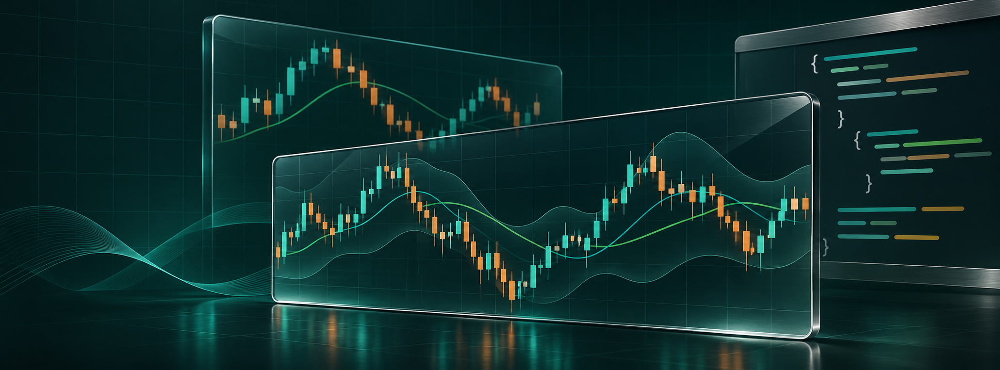
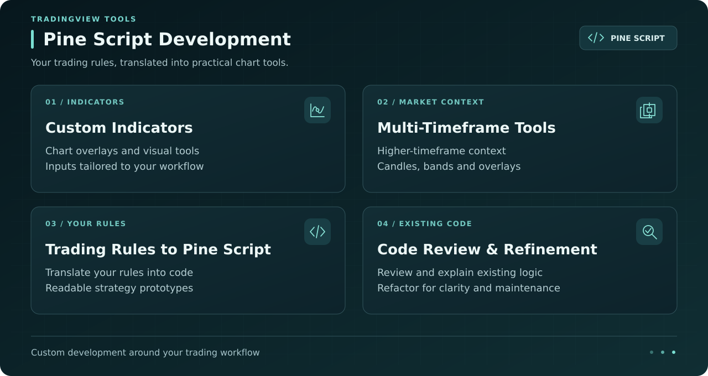

# Pine Script Development for TradingView

**Custom indicators · Multi-timeframe chart tools · Rule-based strategy prototypes**

I develop TradingView tools that turn market concepts and clearly specified trading rules into configurable Pine Script. My work is informed by ten years of hands-on trading experience, from Forex to cryptocurrency markets, alongside Python development and financial ML research.

This portfolio focuses on practical chart tools, readable code, and clearly defined behaviour across timeframes.

 

[Discuss a project on Upwork](https://www.upwork.com/freelancers/~01d554f7011bd884f2) · [LinkedIn](https://www.linkedin.com/in/tim-izmailov-a53524283/) · [GitHub](https://github.com/Tim1l)

## Selected Examples

| Example | What it demonstrates | Customization |
| --- | --- | --- |
| [Confirmed HTF Candles](indicators/confirmed_htf_candles.pine) | The previous completed higher-timeframe candle overlaid on a lower-timeframe chart | Higher timeframe, candle colours, wick visibility |
| [Confirmed HTF Bollinger Bands](indicators/confirmed_htf_bollinger.pine) | Bands calculated in the higher-timeframe context and displayed from the last completed bar | Higher timeframe, length, deviation, colours, line width and fill |

Both examples use closed higher-timeframe values. The display updates as a new higher-timeframe period begins; it does not attempt to show the final values of an unfinished higher-timeframe candle.

See the [usage and chart-check guide](docs/USAGE.md) for settings and a TradingView verification checklist.

## Services

### Custom Indicators
Turn a defined idea into a chart tool with clear inputs, useful visuals, and maintainable source code.

**Typical deliverable:** a Pine Script indicator, settings explanations, and a walkthrough of its behaviour.

### Multi-Timeframe Tools
Build overlays and market-context tools that combine chart timeframes with explicitly defined data availability.

**Typical deliverable:** higher-timeframe candles, bands, or context displays adapted to the client's chart workflow.

### Trading Rules to Pine Script
Translate a client's specified entry, exit, and position-management rules into a strategy prototype.

**Typical deliverable:** an implementation of agreed rules with configurable inputs and an explanation of execution assumptions.

### Code Review & Refinement
Investigate existing Pine code, clarify its behaviour, and improve structure, settings, and chart usability.

**Typical deliverable:** revised source code with a concise explanation of the changes and remaining limitations.

## What I Bring

- Trading-domain experience and an understanding of how tools are used on an actual chart.
- Pine Script v6 development with custom functions, inputs, state, plots, and higher-timeframe data.
- Broader experience building Python software, financial-data tooling, and ML research systems.
- An engineering approach: explicit requirements, readable implementations, and checks against expected behaviour.

## Working Together

1. **Define the behaviour.** Agree on the market, chart timeframe, inputs, visual output, and any trading rules.
2. **Implement the tool.** Develop a focused example that can be reviewed against the requirements.
3. **Review on the chart.** Check settings, timeframe changes, and historical/realtime behaviour in TradingView.
4. **Hand over the source.** Provide the code, usage notes, and an explanation of important assumptions.

A useful starting brief includes:

- Your idea or trading rules in plain language.
- The symbols and timeframes you use.
- A sketch or reference screenshot of the desired output.
- What should happen at a new bar, an entry/exit, or a timeframe boundary.

[Send a project brief on Upwork](https://www.upwork.com/freelancers/~01d554f7011bd884f2)

## Using the Examples
Open a `.pine` file in TradingView's Pine Editor and add it to a standard time-based chart. The default higher timeframe is one hour; a 15-minute chart is a suitable starting point.

Choose a higher timeframe strictly greater than the chart timeframe. Each example intentionally uses the last completed higher-timeframe bar. Detailed behaviour and checks are described in [docs/USAGE.md](docs/USAGE.md).

These examples demonstrate chart-tool development; they do not establish the profitability of a trading strategy.

## License
MIT — see [LICENSE](LICENSE).
